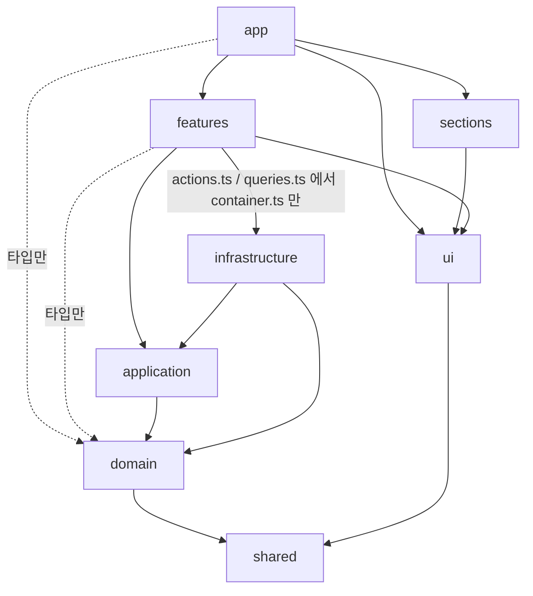

# Machum Studio Portfolio

[](https://github.com/machumstudio/studio-portfolio/actions/workflows/ci.yml)

Figma 시안을 PC / 태블릿 / 모바일 반응형 웹과 간단한 관리자로 구현하는 포트폴리오 데모입니다.
가상의 사진 스튜디오 "Machum Studio" 사이트를 시안 그대로, 빠르게, 운영할 수 있게 만드는 과정을 이 레포의 커밋 순서대로 남깁니다.

- 라이브: TODO (22칸 배포 후)
- Lighthouse (모바일): TODO (20칸 측정 후)
- 시안 재현도: TODO (PR마다 `pnpm test:visual` 차이율 기록, 페이지 완성 후 표로 정리)

## 스택
Next.js 16 (App Router) · TypeScript strict · Tailwind CSS v4 · next-intl (ko/en) · Supabase (Auth/DB/Storage) · react-hook-form + zod · TanStack Query · Zustand · Vitest · Playwright · Storybook · GitHub Actions · Vercel

## 폴더 구조와 의존 규칙
정적인 마케팅 섹션은 props만 받는 단순한 컴포넌트로 두고, 규칙과 외부 의존이 있는 기능(문의, 작업 관리, 관리자 인증)만 레이어를 나눕니다 ([ADR 0003](docs/adr/0003-layered-architecture-ports-and-adapters.md)).

```
src/
  app/                    라우팅과 조립
  components/ui/          디자인 시스템 (Button, Field, HighlightItem ...)
  components/sections/    마케팅 섹션 (데이터는 props로만)
  features/<context>/     기능 UI + 서버 진입점 (actions.ts, queries.ts, schema.ts)
  application/<context>/  유스케이스와 포트
  domain/<context>/       엔티티, 값 객체, 상태 전이 (순수 TS)
  infrastructure/         포트 구현 (Supabase, 이메일, Slack)과 container.ts
  shared/                 Result, Brand, assertNever
```

화살표는 "import 할 수 있다"는 뜻입니다. 이 방향을 벗어나면 `pnpm lint`와 CI가 실패합니다.



- 모든 레이어는 `shared`를 쓸 수 있습니다 (그림에서는 일부 생략)
- `domain`은 React, Next, zod 등 어떤 외부 라이브러리도 import하지 않습니다
- `@supabase/*`, `resend` 같은 외부 SDK는 `infrastructure` 안에서만 import합니다
- Tailwind 임의값(`bg-[#...]`, `text-[17px]`)은 금지이고, Figma 토큰만 씁니다 ([ADR 0001](docs/adr/0001-design-tokens-in-tailwind-theme.md))

전체 규칙표와 데이터 흐름은 [docs/architecture.md](docs/architecture.md)에 있습니다.

## 시작하기
```bash
pnpm install
pnpm dev        # http://localhost:3000 (/ 한국어, /en 영어)
```

## 스크립트
| 명령 | 내용 |
|---|---|
| `pnpm dev` | 개발 서버 |
| `pnpm build` / `pnpm start` | 프로덕션 빌드 / 실행 |
| `pnpm lint` | ESLint (레이어 의존 규칙, SDK import 제한, Tailwind 임의값 금지 포함) |
| `pnpm typecheck` | 라우트 타입 생성 후 `tsc --noEmit` |
| `pnpm test` | Vitest 단위 테스트 |
| `pnpm test:e2e` | Playwright E2E (390 / 1440 / 1920 뷰포트) |
| `pnpm test:visual` | Figma 시안 PNG와 픽셀 비교해 차이율 출력 (로컬 전용, [ADR 0004](docs/adr/0004-visual-regression-against-figma.md)) |
| `pnpm storybook` / `pnpm build-storybook` | Storybook 개발 서버 / 정적 빌드 |
| `pnpm format` | Prettier |

커밋할 때 `commit-msg` 훅(commitlint)과 `pre-commit` 훅(lint-staged)이 자동으로 실행됩니다. 커밋 형식은 [docs/commit-convention.md](docs/commit-convention.md)를 따릅니다.

## 작업 방식
작업표([docs/tasks.md](docs/tasks.md))의 칸마다 이슈 → 브랜치 `slot/NN-name` → PR → CI → Rebase and merge 순서로 진행합니다. 커밋은 논리 단위로 나누고, 커밋 하나하나가 lint/typecheck/test를 통과합니다.

## 결정 기록 (ADR)
| # | 제목 |
|---|---|
| [0001](docs/adr/0001-design-tokens-in-tailwind-theme.md) | 디자인 토큰을 Tailwind `@theme`에 Figma 스타일 이름 그대로 둔다 |
| [0002](docs/adr/0002-i18n-routing.md) | next-intl, 한국어 기본(접두사 없음) + 언어 감지 끔 |
| [0003](docs/adr/0003-layered-architecture-ports-and-adapters.md) | 기능 영역만 레이어 분리 + 포트/어댑터 |
| [0004](docs/adr/0004-visual-regression-against-figma.md) | Figma 시안과 픽셀 비교로 재현도 측정 |
| [0005](docs/adr/0005-issue-pr-ci-workflow.md) | 칸 단위 이슈 → PR → CI |

## 크레딧
- Design by [Produce UI](https://www.figma.com/community/file/1324089527430438614) (CC BY 4.0) — "Photographer Portfolio Website UI Template - Dark Theme". 반응형 구현, 태블릿 레이아웃, 작업 상세, 관리자, 다국어를 추가했고 문구와 사진을 바꿨습니다.
- 사진: Unsplash (출처는 [CREDITS.md](CREDITS.md))
- 폰트: Manrope (SIL Open Font License)
