# Machum Studio Portfolio

[](https://github.com/machumstudio/studio-portfolio/actions/workflows/ci.yml)

Figma 시안을 PC / 태블릿 / 모바일 반응형 웹과 간단한 관리자로 구현하는 포트폴리오 데모입니다.
가상의 사진 스튜디오 "Machum Studio" 사이트를 시안 그대로, 빠르게, 운영할 수 있게 만드는 과정을 이 레포의 커밋 순서대로 남깁니다.

- **라이브: https://machum-studio.vercel.app** (영어 `/en`, 관리자 `/admin/login`)
- 운영 매뉴얼: [docs/ops-manual.md](docs/ops-manual.md) (운영자용 관리자 사용법, 서비스 한도, 개발자 인수인계)
- 요구사항 → 구현 매핑, 케이스 스터디: TODO (23칸, [docs/requirements.md](docs/requirements.md) 기반)

## 화면
| 홈 | 포트폴리오 |
|---|---|
| 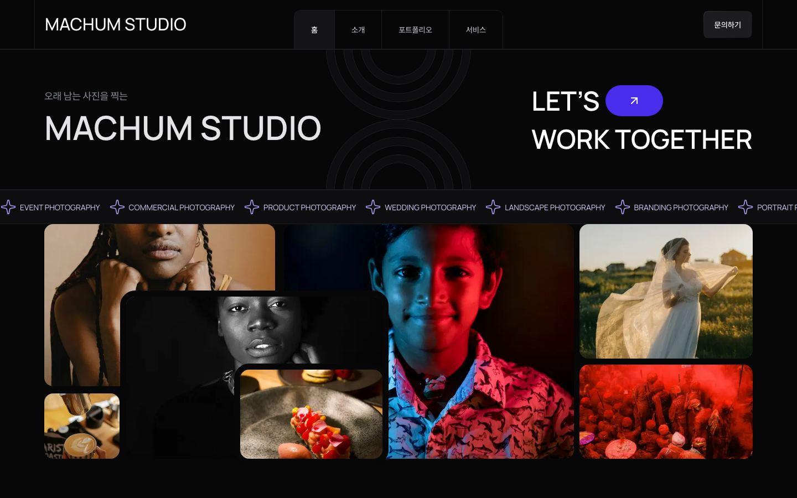 | 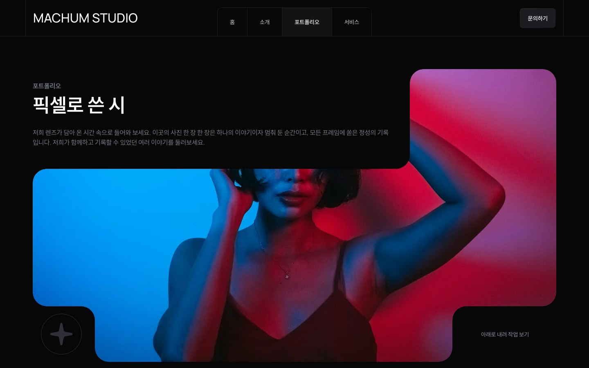 |
| **작업 상세** | **문의** |
| 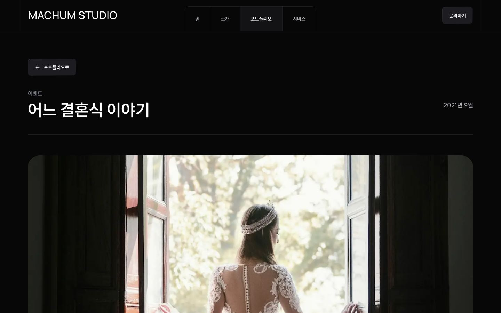 | 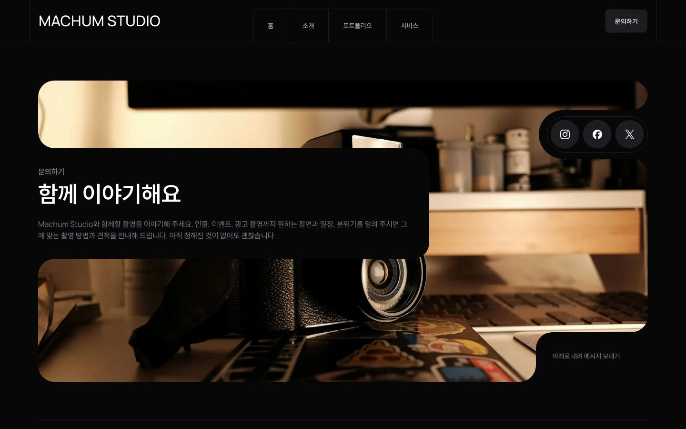 |

| 모바일 390 홈 | 포트폴리오 | 작업 상세 | 문의 |
|---|---|---|---|
| 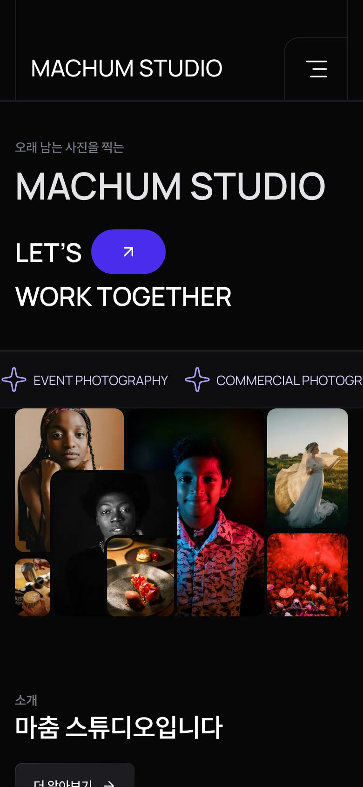 | 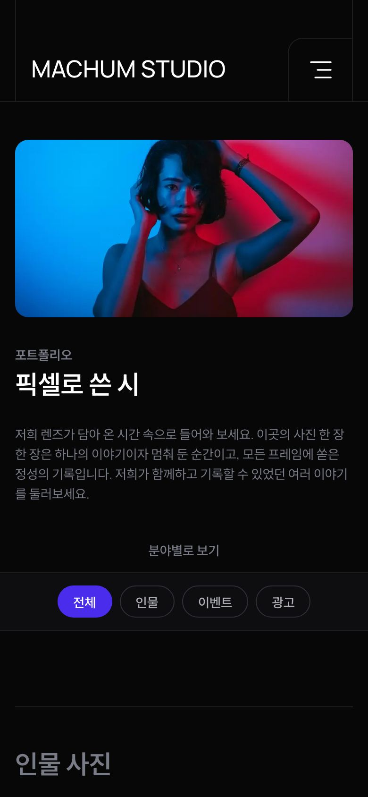 | 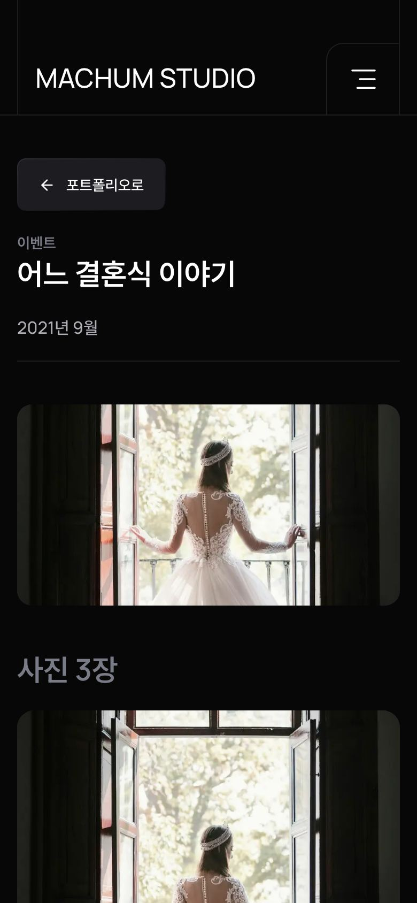 | 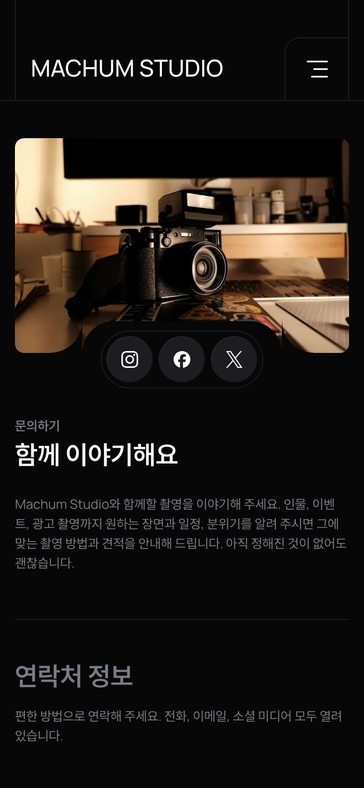 |

관리자 (작업 목록, 사진 편집, 문의 목록, 문의 상세)

| 작업 목록 | 사진 편집 |
|---|---|
| 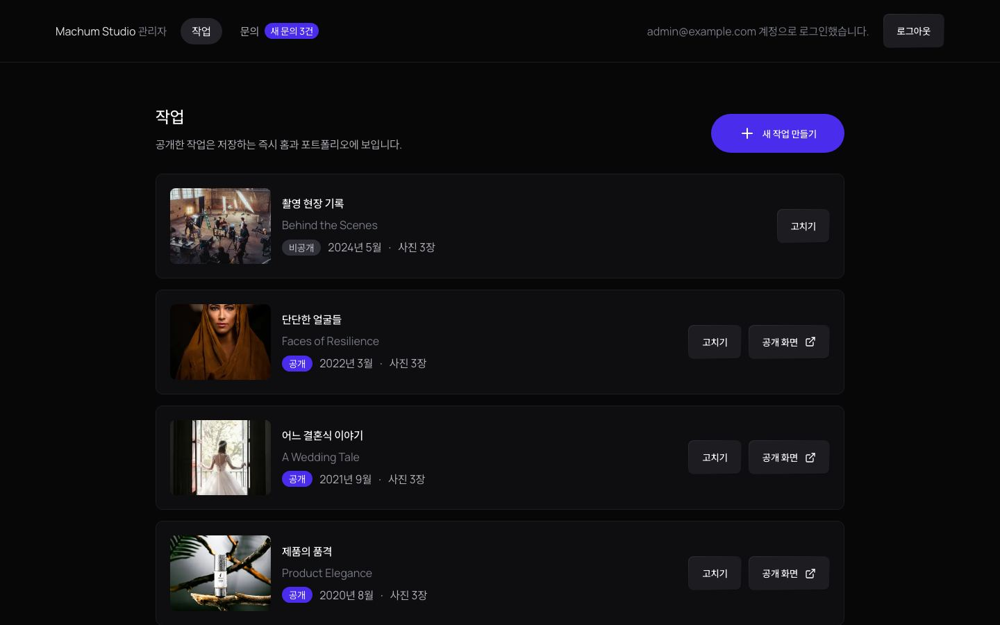 | 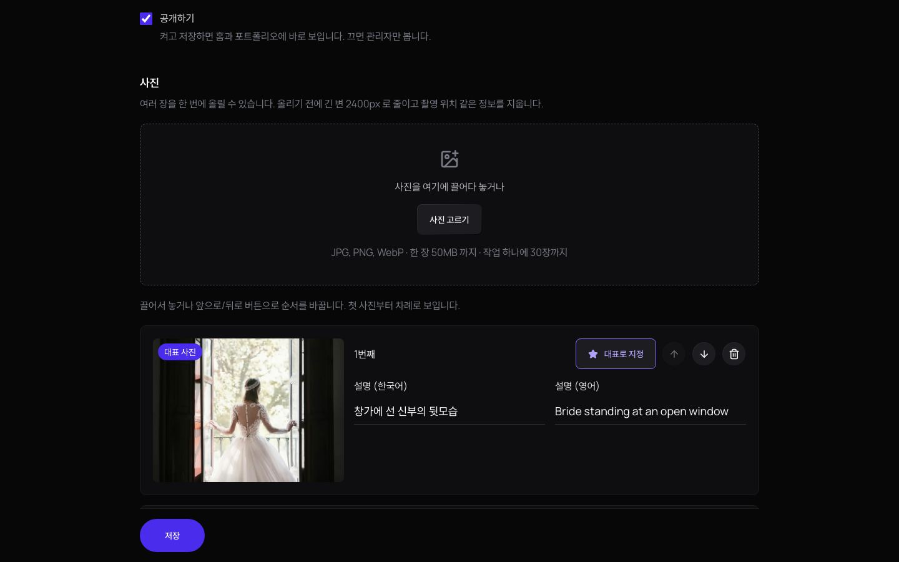 |
| **문의 목록** | **문의 상세** |
| 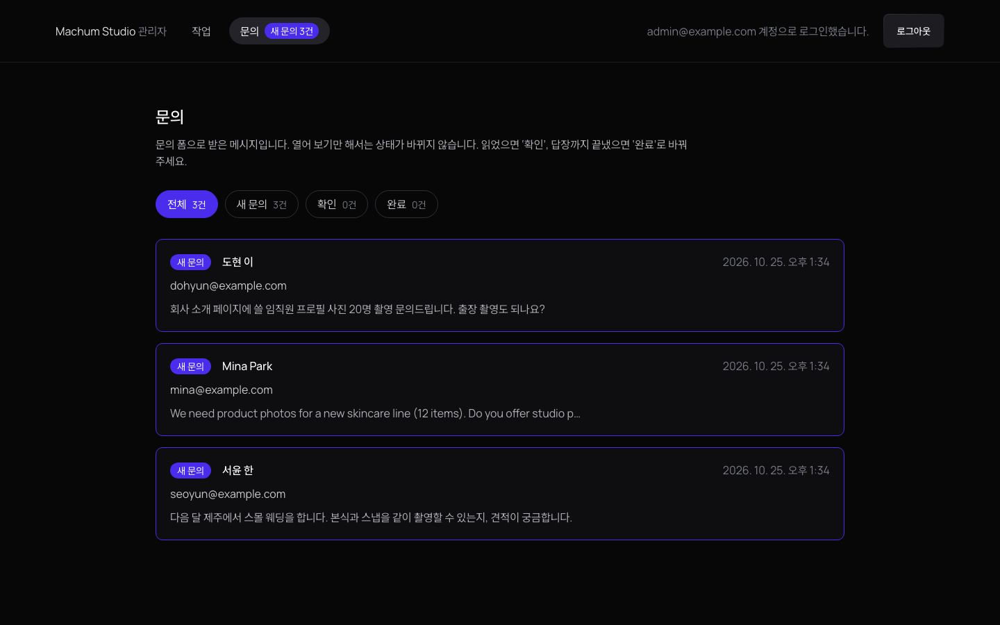 | 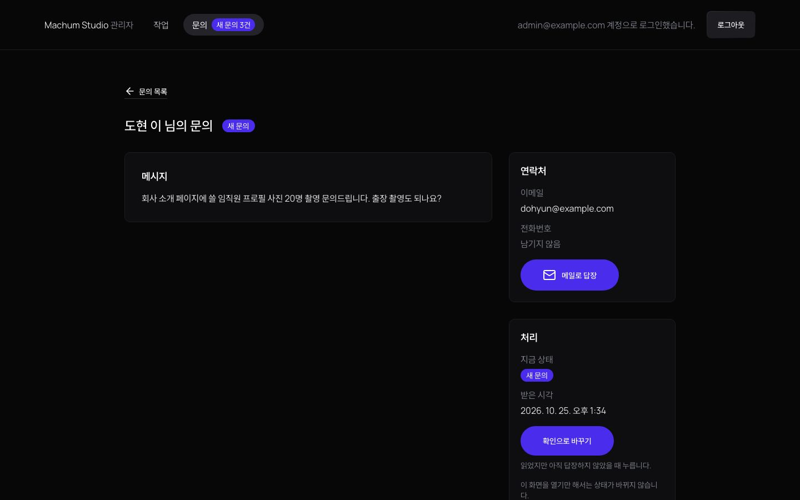 |

스크린샷은 로컬 운영 빌드(인메모리 저장소, 시드 작업)에서 찍었습니다. 관리자 화면은 테스트 계정과 가상 문의입니다 (실제 관리자 계정과 운영 데이터는 쓰지 않음).

## Lighthouse
> **운영 주소 https://machum-studio.vercel.app 기준 (2026-10-25, 첫 운영 배포 뒤).**

| 페이지 | 모바일 성능 | 데스크톱 성능 | 접근성 | 권장사항 | SEO |
|---|---|---|---|---|---|
| 홈 `/` | 99 (98~100) | 100 | 100 | 100 | 100 |
| 포트폴리오 `/portfolio` | 98 (98~99) | 100 | 100 | 100 | 100 |
| 작업 상세 `/work/a-wedding-tale` | 97 (94~99) | 100 (99~100) | 100 | 100 | 100 |
| 소개 `/about` | 98 (98~99) | 100 | 100 | 100 | 100 |
| 서비스 `/services` | 98 (97~99) | 100 | 100 | 100 | 100 |
| 문의 `/contact` | 98 | 100 | 100 | 100 | 100 |

- 성능은 3회 중앙값(괄호는 회차별 최소~최대, 세 회차가 같으면 생략). 접근성/권장사항/SEO 는 모바일·데스크톱 같음. 페이지마다 첫 회(이미지 최적화 캐시가 처음 만들어지는 회차)는 버림
- 측정 조건: 2026-10-25, 운영 주소(Vercel Hobby, CDN 엣지 서울 `icn1`, 운영 DB 는 페이지 읽기만), Lighthouse 13.5.0, Playwright Chromium, Apple M5. 모바일은 Lighthouse 기본(느린 4G·CPU 4배 감속 시뮬레이션), 데스크톱은 desktop 설정
- 로컬 운영 빌드에서는 한글 글꼴 Pretendard 조각이 시뮬레이션에서 첫 화면 앞에 끼는 회차가 있어 모바일 성능이 78~97(회차별 68~99)로 흔들렸습니다 ([ADR 0017](docs/adr/0017-keep-pretendard-and-its-cost.md)). 운영 주소에서는 그런 회차가 없었습니다 (FCP 1.1s~1.6s). 이유는 확인하지 않았고, 한 번 잰 결과입니다
- 전체 표(LCP/CLS/TBT/FCP), 로컬 값과의 비교, 다시 재는 방법: [docs/performance.md](docs/performance.md)

## 시안 재현도
`pnpm test:visual`: Playwright 전체 페이지 스크린샷을 Figma 시안 PNG 와 픽셀 비교한 차이율입니다 (낮을수록 시안과 같음, 사진 영역은 양쪽 모두 가리고 비교, [ADR 0004](docs/adr/0004-visual-regression-against-figma.md)). 2026-10-25, 22칸.

| 페이지 | 모바일 390 | 노트북 1440 | 데스크톱 1920 |
|---|---|---|---|
| 홈 | 7.22% | 4.26% | 3.11% |
| 포트폴리오 | 10.19% | 3.80% | 2.91% |
| 소개 | 16.28% | 8.83% | 8.16% |
| 서비스 | 13.32% | 3.30% | 3.16% |
| 문의 | 10.10% | 6.14% | 5.45% |

- 시안은 영어 문구, 비교는 한국어 기본 페이지라 글자 모양과 줄바꿈이 다르고, 그만큼 페이지 높이가 달라져 아래 섹션이 밀립니다. 모바일이 높은 이유도 대부분 이것입니다 (좁은 폭에서 줄 수 차이가 큼)
- 시안에서 바꾼 것도 차이에 들어갑니다: 접근성 색 대비(Grey/40 → Grey/50), 포트폴리오 브랜드 띠 자리의 카테고리 필터
- 섹션별 차이율과 칸마다의 변화는 각 PR 본문에 있습니다

## 스택
Next.js 16 (App Router) · TypeScript strict · Tailwind CSS v4 · next-intl (ko/en) · Supabase (Auth/DB/Storage) · zod (문의 폼은 react-hook-form 없이 서버 액션 + domain 검증, ADR 0009) · Vitest · Playwright · Storybook · GitHub Actions · Vercel

## 폴더 구조와 의존 규칙
정적인 마케팅 섹션은 props만 받는 단순한 컴포넌트로 두고, 규칙과 외부 의존이 있는 기능(문의, 작업 관리, 관리자 인증)만 레이어를 나눕니다 ([ADR 0003](docs/adr/0003-layered-architecture-ports-and-adapters.md)).

```
src/
  app/                    라우팅과 조립
  components/ui/          디자인 시스템 (Button, Field, HighlightItem ...)
  components/sections/    마케팅 섹션 (데이터는 props로만)
  features/<context>/     기능 UI + 서버 진입점 (actions.ts, queries.ts, schema.ts)
  application/<context>/  유스케이스와 포트
  domain/<context>/       엔티티, 값 객체, 상태 전이 (순수 TS)
  infrastructure/         포트 구현 (Supabase, 이메일, Slack)과 container.ts
  shared/                 Result, Brand, assertNever
```

화살표는 "import 할 수 있다"는 뜻입니다. 이 방향을 벗어나면 `pnpm lint`와 CI가 실패합니다.

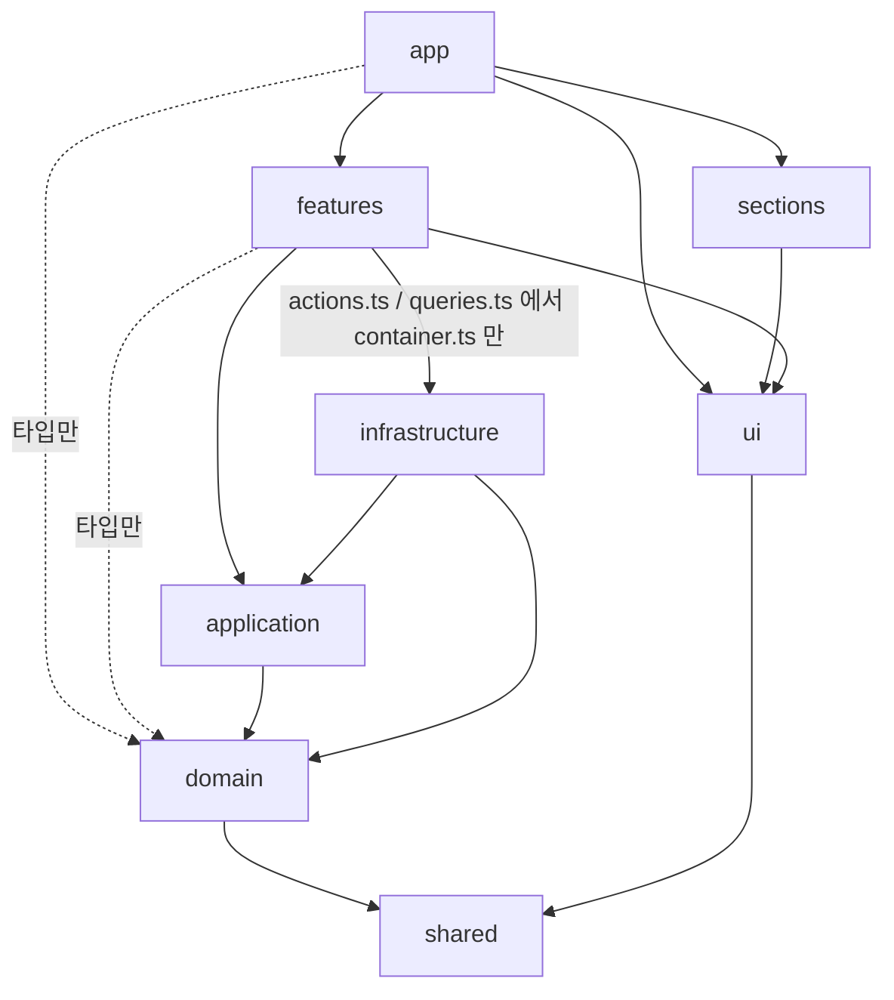

- 모든 레이어는 `shared`를 쓸 수 있습니다 (그림에서는 일부 생략)
- `domain`은 React, Next, zod 등 어떤 외부 라이브러리도 import하지 않습니다
- `@supabase/*`, `resend` 같은 외부 SDK는 `infrastructure` 안에서만 import합니다
- Tailwind 임의값(`bg-[#...]`, `text-[17px]`)은 금지이고, Figma 토큰만 씁니다 ([ADR 0001](docs/adr/0001-design-tokens-in-tailwind-theme.md))

전체 규칙표와 데이터 흐름은 [docs/architecture.md](docs/architecture.md)에 있습니다.

## 시작하기
```bash
pnpm install
pnpm dev        # http://localhost:3000 (/ 한국어, /en 영어)
```
env 없이도 인메모리 저장소(코드 시드)로 모든 화면이 동작합니다. 문의는 서버를 다시 띄우면 비워집니다.

## Supabase 연결
작업과 문의를 Supabase(클라우드 무료 플랜 프로젝트 1개, 개발+테스트 공용)에 저장합니다. Docker 와 로컬 Supabase 는 쓰지 않습니다.
`src/infrastructure/container.ts` 가 env 를 보고 저장소를 고릅니다: URL + secret 키가 있으면 Supabase, 없거나 `DATA_STORE=memory` 면 인메모리.

### 1. 로컬 env 준비
```bash
cp .env.example .env.local   # .env.local 은 커밋하지 않습니다
```
| 변수 | 어디서 | 용도 |
|---|---|---|
| `NEXT_PUBLIC_SUPABASE_URL` | Project Settings > Data API | 공개 값 |
| `NEXT_PUBLIC_SUPABASE_PUBLISHABLE_KEY` | Project Settings > API Keys (`sb_publishable_...`) | 공개 값. RLS 로 공개 작업 읽기만 됩니다 |
| `SUPABASE_SECRET_KEY` | Project Settings > API Keys (`sb_secret_...`) | 서버 전용. RLS 를 우회합니다. `NEXT_PUBLIC_` 을 붙이지 않습니다 |
| `SUPABASE_DB_URL` | Connect > Session pooler (IPv4) | 마이그레이션 적용에만 씁니다 |

레거시 `anon` / `service_role` 키는 쓰지 않습니다. 무료 플랜의 Direct connection 은 IPv6 전용이라, IPv4 add-on 없이 쓰려면 Session pooler 주소를 씁니다.

### 2. 마이그레이션 적용
`supabase/migrations/` 의 SQL 을 원격 DB 에 적용합니다. CLI 는 devDependency 라 따로 설치하지 않습니다. CI 는 마이그레이션을 적용하지 않습니다.
```bash
set -a; . ./.env.local; set +a
pnpm exec supabase db push --db-url "$SUPABASE_DB_URL" --dry-run   # 적용할 파일 확인
pnpm exec supabase db push --db-url "$SUPABASE_DB_URL"
pnpm db:seed                                                        # works 를 코드 시드로 채움 (문의는 그대로)
```
마이그레이션을 바꾸면 `src/infrastructure/supabase/database.ts` 의 테이블 타입도 같이 고칩니다 (`supabase gen types` 는 `--db-url` 에 Docker 가 필요해서 손으로 맞춥니다).

### 3. 테스트
| 명령 | 클라우드 DB |
|---|---|
| `pnpm test` | 건드리지 않음 (`*.contract.test.ts` 제외) |
| `pnpm test:e2e`, `pnpm test:visual` | 건드리지 않음 (Playwright 서버를 `DATA_STORE=memory` 로 띄움) |
| `pnpm test:contract` | 씀. 리포지토리/인증/사진 저장소 계약, publishable 키와 관리자 세션 RLS(테이블, `save_work` 함수, `work-photos` 버킷), 공개 가입·익명 로그인 차단, DB 제약. 테이블을 비우고 채운 뒤 works 시드와 기존 문의를 되돌립니다. Auth 계정과 Storage 파일은 실행마다 임시로 만들고(`contract-<run>/`, `rls-<run>/` 폴더) 지웁니다 (실제 관리자 계정은 쓰지 않음). env 가 없으면 건너뜁니다 |

CI 는 `Contract` 워크플로(`.github/workflows/contract.yml`)가 Actions secrets(`NEXT_PUBLIC_SUPABASE_URL`, `NEXT_PUBLIC_SUPABASE_PUBLISHABLE_KEY`, `SUPABASE_SECRET_KEY`)로 계약 테스트를 돌립니다. 같은 DB 를 쓰므로 레포 전체에서 한 번에 하나만 돕니다.
계약 테스트가 도중에 끊겨 화면에 테스트 작업이 보이면 `pnpm db:seed` 로 되돌립니다.

secret 키가 브라우저로 가는 파일에 없는지는 `pnpm build && pnpm check:bundle` 로 확인합니다 (CI 도 빌드 뒤에 실행).

### 무료 플랜 일시정지와 Resume
무료 플랜 프로젝트는 7일 동안 활동이 없으면 일시정지됩니다. 정지되면 앱의 Supabase 요청과 `Contract` 워크플로가 실패합니다.
1. [Supabase 대시보드](https://supabase.com/dashboard) 에서 프로젝트를 엽니다 (일시정지 배너가 보입니다)
2. **Resume project**(또는 Restore project)를 누르고 상태가 Healthy 가 될 때까지 몇 분 기다립니다. 테이블과 데이터는 그대로 남아 있습니다
3. `pnpm test:contract` 로 연결을 확인합니다
기다리는 동안 로컬 개발은 `.env.local` 에 `DATA_STORE=memory` 를 넣어 인메모리로 할 수 있습니다.

## 문의 알림 메일 (Resend)
새 문의가 저장되면 관리자에게 한국어 메일을 보냅니다. 제목에 이름, 본문에 이름/이메일/연락처/메시지/접수 시각(KST)/문의 ID가 들어가고, Reply-To 가 문의자라 바로 답장할 수 있습니다.
`src/infrastructure/container.ts` 가 env 를 보고 고릅니다: 키 + 받는 주소가 있으면 Resend, 없거나 `DATA_STORE=memory` 면 서버 로그(문의 ID 와 시각만).

| 변수 | 어디서 | 용도 |
|---|---|---|
| `RESEND_API_KEY` | Resend > API Keys (Sending access) | 서버 전용. `NEXT_PUBLIC_` 을 붙이지 않습니다 |
| `INQUIRY_NOTIFY_EMAIL` | 받는 사람 | 도메인을 인증하기 전에는 Resend 계정 주인 주소만 됩니다 |
| `INQUIRY_FROM_EMAIL` | 선택 | 보내는 주소. 비우면 `Machum Studio <onboarding@resend.dev>`. 도메인을 인증하면 바꿉니다 |

- 메일이 실패하거나(네트워크, 4xx/5xx, 무료 한도 429) 5초 안에 응답이 없으면 문의는 저장된 채로 접수 완료가 되고, 서버 로그에 `NotificationFailed` 경고가 남습니다 ([ADR 0007](docs/adr/0007-inquiry-notification-failure-is-warning.md)). 놓친 문의는 관리자 목록에서 확인합니다
- 로그와 에러 메시지에는 키, 메일 주소, 문의 내용을 남기지 않습니다
- `pnpm test`, `pnpm test:e2e`, CI 는 실제로 보내지 않습니다 (단위 테스트는 가짜 fetch, e2e 는 `DATA_STORE=memory`)

## 관리자 로그인
`/admin/login` 에서 이메일과 비밀번호로 로그인하면 `/admin`(작업 목록)으로 갑니다. 관리자 화면은 한국어만 있고 검색에서 빠집니다 ([ADR 0013](docs/adr/0013-admin-routes-ko-only-and-static-login.md)).

- 관리자 계정: Supabase 대시보드 > Authentication 에서 만들고 `app_metadata.role` 을 `"admin"` 으로 둡니다 (SQL: `update auth.users set raw_app_meta_data = raw_app_meta_data || '{"role":"admin"}' where email = ...`). 공개 가입과 익명 로그인은 꺼 둡니다. `user_metadata` 는 사용자가 고칠 수 있어 보지 않습니다
- 보호: proxy 가 `/admin` 이하에서 세션 쿠키를 빠르게 보고(서명/만료, 토큰 갱신) 아니면 로그인으로 보냅니다. 화면과 서버 액션은 인증 서버에 세션을 다시 확인합니다. 테이블은 관리자 세션 + RLS `role=admin` 정책으로 씁니다 ([ADR 0012](docs/adr/0012-admin-data-access-via-rls.md))
- 로그인 실패 문구는 하나입니다 (없는 이메일, 틀린 비밀번호, 관리자 아님을 구분하지 않음). 로그인 뒤 돌아갈 곳은 같은 사이트의 `/admin` 경로만 받습니다
- env: Supabase URL + publishable 키가 있으면 Supabase Auth, `DATA_STORE=memory` 면 테스트 계정(`src/infrastructure/admin-auth/memory-accounts.ts`, e2e 용), 둘 다 없으면 꺼져서 아무도 로그인하지 못합니다. 테스트 계정은 Vercel production 에서는 켜지지 않습니다
- 자동 테스트는 실제 관리자 계정을 쓰지 않습니다 (e2e 는 테스트 계정, 계약 테스트는 실행마다 임시 계정을 만들고 지움)

## 관리자 작업 관리
`/admin` 작업 목록(대표 사진, 제목, 공개 여부, 촬영 연월) → `/admin/works/new`(새 작업), `/admin/works/[id]`(고치기).

- 사진: 끌어다 놓거나 "사진 고르기"로 여러 장. JPG/PNG/WebP, 원본 한 장 50MB, 작업당 30장. 브라우저가 긴 변 2400 으로 줄이고 다시 인코딩해(촬영 위치 같은 EXIF 가 지워짐) Storage 로 직접 올립니다. 비율은 제한하지 않습니다
- 순서는 끌어서 놓기 또는 앞으로/뒤로 버튼, 대표는 "대표로 지정" 버튼. 첫 사진이 대표로 시작하고, 대표를 빼면 남은 첫 사진이 대표가 됩니다
- 저장하면 공개 화면(홈, 포트폴리오, 상세)의 캐시를 바로 비웁니다. 지우기는 확인 단계를 거치고, 작업이나 사진을 지우면 Storage 파일도 지웁니다 (저장하지 않고 떠난 새 작업의 사진은 하루 뒤 다음 저장 때 정리)
- Storage: 공개 버킷 `work-photos` (마이그레이션 `20261025000002`). 쓰기/목록/지우기는 관리자 세션만, 덮어쓰기는 아무도 못 합니다. 공개 버킷이라 **비공개 작업의 사진도 주소를 알면 열립니다** (주소는 추측할 수 없음, [ADR 0014](docs/adr/0014-work-photos-public-bucket.md))
- 편집 화면은 JS 가 필요합니다. 상태는 서버 컴포넌트 + 서버 액션 + `useReducer` 이고 TanStack Query/Zustand 는 쓰지 않습니다 ([ADR 0015](docs/adr/0015-admin-editor-requires-js.md))
- `DATA_STORE=memory` 면 작업과 사진이 서버 메모리에 있고(다시 띄우면 시드로 돌아감) 업로드는 `/admin/uploads/[token]`, 사진은 `/media/work-photos/...` 로 같은 흐름을 탑니다

## 관리자 문의 관리
`/admin/inquiries` 문의 목록 → `/admin/inquiries/[id]` 문의 상세. 관리자 메뉴에 "새 문의 N건"이 보입니다.

- 목록: 최신순 20건씩, 상태 필터(전체/새 문의/확인/완료)와 상태별 개수, 이름·이메일·받은 시각(KST)·상태·메시지 앞부분. 필터와 페이지는 주소(`?status=new&page=2`)에 남습니다
- 상세: 전체 메시지(줄바꿈 그대로), 연락처, 받은 시각과 확인/완료한 시각. 버튼은 지금 상태에서 할 수 있는 것만 보입니다 (새 문의 → 확인, 확인 → 완료, 완료 → 다시 열기). "메일로 답장"은 받는 사람과 제목을 채운 메일 앱을 엽니다
- 상세를 열기만 해서는 "확인"으로 바뀌지 않습니다. 잘못 연 문의가 새 문의에서 사라지지 않게 운영자가 직접 바꿉니다
- 다른 탭이나 휴대폰에서 먼저 상태를 바꿨으면 "먼저 바꿨습니다" 알림과 함께 지금 상태를 다시 보여 줍니다. 상태 버튼과 필터는 JS 없이도 됩니다 ([ADR 0016](docs/adr/0016-admin-inquiries-url-state-and-post-redirect.md))
- 지우기는 확인 창을 거쳐 문의와 연락처를 완전히 지웁니다 (되돌릴 수 없음). 서버 로그에는 문의 ID 와 에러 종류만 남습니다
- 문의가 1000건을 넘어도 목록과 개수가 잘리지 않습니다 (저장소에서 범위로 읽고 개수는 따로 셈)

## 검색 노출과 예전 주소 (SEO)
- 사이트 주소: `NEXT_PUBLIC_SITE_URL` (비우면 Vercel 운영 도메인, 미리보기 주소, `http://localhost:3000` 순). canonical, hreflang(ko/en + x-default), sitemap, 공유 카드가 이 주소를 씁니다
- 검색 색인은 Vercel 운영 배포(`VERCEL_ENV=production`)만 됩니다. 미리보기와 로컬 빌드는 모든 응답에 `X-Robots-Tag: noindex` 가 붙습니다 ([ADR 0018](docs/adr/0018-seo-site-url-and-preview-noindex.md))
- `/sitemap.xml`: 공개 페이지와 공개 작업(ko/en). 관리자가 작업을 저장/공개 전환/지우면 바로 다시 만들어집니다. `/robots.txt`: `/admin` 차단 + sitemap 주소
- 예전 사이트 주소의 301: `src/lib/seo/legacy-redirects.ts` 목록에 `{ from, to }` 한 줄을 더합니다 (언어 경로는 자동). 도착지가 없는 페이지이거나 다른 규칙을 다시 타면 `pnpm test` 가 실패합니다
- 공유 카드 기본 이미지: `public/og/machum-studio-<ko|en>.jpg` (1200x630). 문구를 바꾸면 `pnpm og:image` 로 다시 그립니다. 작업 상세는 대표 사진이 카드입니다

## 배포와 운영
- Vercel(Hobby): main 에 머지하면 운영 배포(운영 Supabase, 색인 허용), PR 은 미리보기 배포(개발 Supabase, noindex, Vercel 로그인 보호)
- 운영 빌드는 운영 DB 의 공개 작업을 읽어 페이지를 미리 그립니다. 그래서 DB 가 멈춰 있으면 빌드가 실패하고 직전 배포가 계속 나갑니다. 새 테이블/컬럼은 머지 전에 운영 DB 에 먼저 적용합니다
- Supabase 무료 플랜의 7일 비활성 일시정지는 Vercel cron 이 매일 `GET /api/keepalive` 로 저장소를 한 번 읽어 막습니다 ([ADR 0021](docs/adr/0021-free-tier-operations.md))
- 환경 변수 목록, 마이그레이션 적용, 키 교체, 관리자 추가, 서비스 한도: [docs/ops-manual.md](docs/ops-manual.md)

## 스크립트
| 명령 | 내용 |
|---|---|
| `pnpm dev` | 개발 서버 |
| `pnpm build` / `pnpm start` | 프로덕션 빌드 / 실행 |
| `pnpm lint` | ESLint (레이어 의존 규칙, SDK import 제한, Tailwind 임의값 금지 포함) |
| `pnpm typecheck` | 라우트 타입 생성 후 `tsc --noEmit` |
| `pnpm test` | Vitest 단위 테스트 (클라우드 DB 를 쓰지 않음) |
| `pnpm test:contract` | Supabase 계약/RLS/제약 테스트 (env 없으면 건너뜀) |
| `pnpm test:e2e` | Playwright E2E. 화면 크기와 상관없는 테스트는 1440 하나, `@responsive` 만 390 / 1440 / 1920 (기준은 `playwright.config.ts` 주석) |
| `pnpm test:delivery` | 납품 확인용 핵심 흐름 2개만 (`@delivery`): 방문자 문의 → 관리자 처리, 관리자 작업 등록(사진) → 공개 → 포트폴리오/sitemap |
| `pnpm test:visual` | Figma 시안 PNG와 픽셀 비교해 차이율 출력 (로컬 전용, [ADR 0004](docs/adr/0004-visual-regression-against-figma.md)) |
| `pnpm storybook` / `pnpm build-storybook` | Storybook 개발 서버 / 정적 빌드 |
| `pnpm db:seed` | Supabase works 를 코드 시드로 되돌림 |
| `pnpm og:image` | 공유 카드 기본 이미지(1200x630, ko/en)를 다시 그림 |
| `pnpm lighthouse` | 공개 페이지 6개 × 모바일/데스크톱 Lighthouse 표 (중앙값, 회차별 성능, FCP 범위. 로컬 운영 빌드를 띄운 뒤, 또는 `--base https://machum-studio.vercel.app`, [docs/performance.md](docs/performance.md)) |
| `pnpm check:bundle` | 빌드 결과의 클라이언트 번들에 서버 비밀이 없는지 검사 |
| `pnpm format` | Prettier |

커밋할 때 `commit-msg` 훅(commitlint)과 `pre-commit` 훅(lint-staged)이 자동으로 실행됩니다. 커밋 형식은 [docs/commit-convention.md](docs/commit-convention.md)를 따릅니다.

## 작업 방식
작업표([docs/tasks.md](docs/tasks.md))의 칸마다 이슈 → 브랜치 `slot/NN-name` → PR → CI → Rebase and merge 순서로 진행합니다. 커밋은 논리 단위로 나누고, 커밋 하나하나가 lint/typecheck/test를 통과합니다.
main 은 보호 브랜치입니다: PR 필수(승인 0), CI 통과 필수, 최신 main 기준 필수, 선형 히스토리, 우회 금지, force push/삭제 금지 ([ADR 0005](docs/adr/0005-issue-pr-ci-workflow.md)).

## 결정 기록 (ADR)
| # | 제목 |
|---|---|
| [0001](docs/adr/0001-design-tokens-in-tailwind-theme.md) | 디자인 토큰을 Tailwind `@theme`에 Figma 스타일 이름 그대로 둔다 |
| [0002](docs/adr/0002-i18n-routing.md) | next-intl, 한국어 기본(접두사 없음) + 언어 감지 끔 |
| [0003](docs/adr/0003-layered-architecture-ports-and-adapters.md) | 기능 영역만 레이어 분리 + 포트/어댑터 |
| [0004](docs/adr/0004-visual-regression-against-figma.md) | Figma 시안과 픽셀 비교로 재현도 측정 |
| [0005](docs/adr/0005-issue-pr-ci-workflow.md) | 칸 단위 이슈 → PR → CI |
| [0006](docs/adr/0006-site-route-group.md) | 공개 사이트 공통 틀은 `(site)` 라우트 그룹 레이아웃 |

0007~0021(문의 알림, 관리자, SEO, 무료 플랜 운영 등)은 [docs/adr/README.md](docs/adr/README.md) 에 전체 목록이 있습니다.

## 크레딧
- Design by [Produce UI](https://www.figma.com/community/file/1324089527430438614) (CC BY 4.0) — "Photographer Portfolio Website UI Template - Dark Theme". 반응형 구현, 태블릿 레이아웃, 작업 상세, 관리자, 다국어를 추가했고 문구와 사진을 바꿨습니다.
- 사진: Unsplash (출처는 [CREDITS.md](CREDITS.md))
- 폰트: Manrope (SIL Open Font License)
