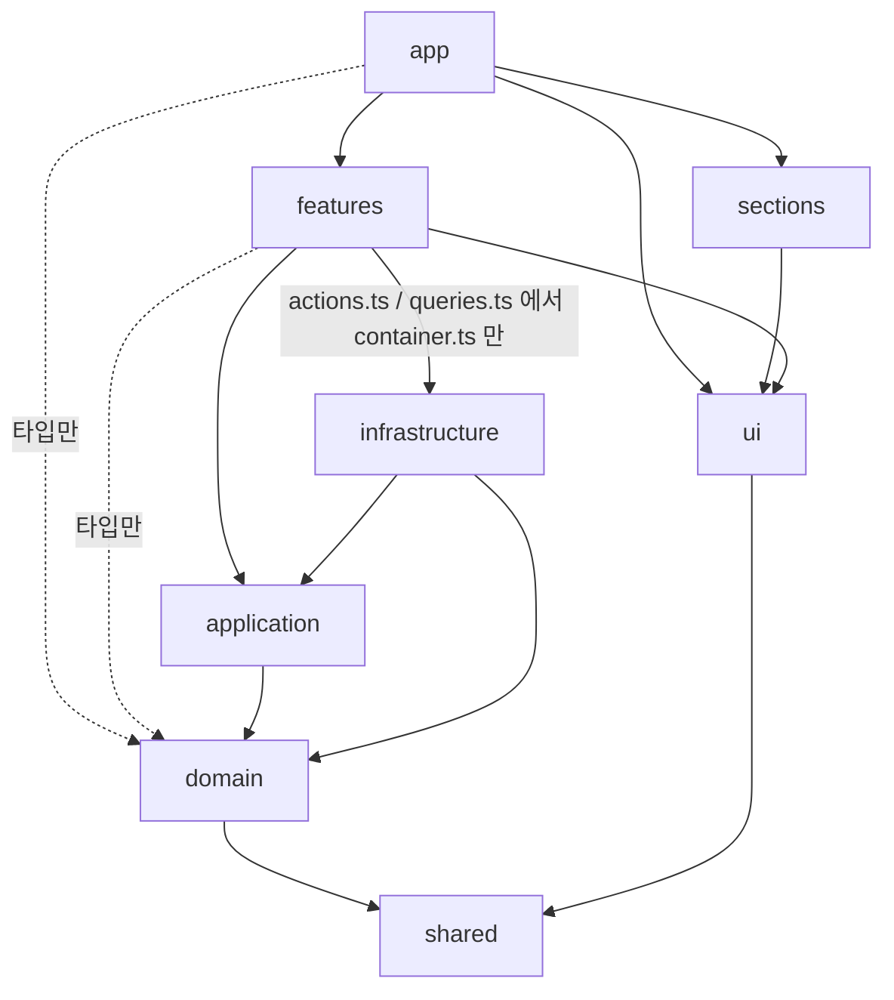

# Machum Studio Portfolio

[](https://github.com/machumstudio/studio-portfolio/actions/workflows/ci.yml)

Figma 시안을 PC / 태블릿 / 모바일 반응형 웹과 간단한 관리자로 구현하는 포트폴리오 데모입니다.
가상의 사진 스튜디오 "Machum Studio" 사이트를 시안 그대로, 빠르게, 운영할 수 있게 만드는 과정을 이 레포의 커밋 순서대로 남깁니다.

- 라이브: TODO (22칸 배포 후)
- Lighthouse (모바일): TODO (20칸 측정 후)
- 시안 재현도: TODO (PR마다 `pnpm test:visual` 차이율 기록, 페이지 완성 후 표로 정리)

## 스택
Next.js 16 (App Router) · TypeScript strict · Tailwind CSS v4 · next-intl (ko/en) · Supabase (Auth/DB/Storage) · react-hook-form + zod · TanStack Query · Zustand · Vitest · Playwright · Storybook · GitHub Actions · Vercel

## 폴더 구조와 의존 규칙
정적인 마케팅 섹션은 props만 받는 단순한 컴포넌트로 두고, 규칙과 외부 의존이 있는 기능(문의, 작업 관리, 관리자 인증)만 레이어를 나눕니다 ([ADR 0003](docs/adr/0003-layered-architecture-ports-and-adapters.md)).

```
src/
  app/                    라우팅과 조립
  components/ui/          디자인 시스템 (Button, Field, HighlightItem ...)
  components/sections/    마케팅 섹션 (데이터는 props로만)
  features/<context>/     기능 UI + 서버 진입점 (actions.ts, queries.ts, schema.ts)
  application/<context>/  유스케이스와 포트
  domain/<context>/       엔티티, 값 객체, 상태 전이 (순수 TS)
  infrastructure/         포트 구현 (Supabase, 이메일, Slack)과 container.ts
  shared/                 Result, Brand, assertNever
```

화살표는 "import 할 수 있다"는 뜻입니다. 이 방향을 벗어나면 `pnpm lint`와 CI가 실패합니다.



- 모든 레이어는 `shared`를 쓸 수 있습니다 (그림에서는 일부 생략)
- `domain`은 React, Next, zod 등 어떤 외부 라이브러리도 import하지 않습니다
- `@supabase/*`, `resend` 같은 외부 SDK는 `infrastructure` 안에서만 import합니다
- Tailwind 임의값(`bg-[#...]`, `text-[17px]`)은 금지이고, Figma 토큰만 씁니다 ([ADR 0001](docs/adr/0001-design-tokens-in-tailwind-theme.md))

전체 규칙표와 데이터 흐름은 [docs/architecture.md](docs/architecture.md)에 있습니다.

## 시작하기
```bash
pnpm install
pnpm dev        # http://localhost:3000 (/ 한국어, /en 영어)
```
env 없이도 인메모리 저장소(코드 시드)로 모든 화면이 동작합니다. 문의는 서버를 다시 띄우면 비워집니다.

## Supabase 연결
작업과 문의를 Supabase(클라우드 무료 플랜 프로젝트 1개, 개발+테스트 공용)에 저장합니다. Docker 와 로컬 Supabase 는 쓰지 않습니다.
`src/infrastructure/container.ts` 가 env 를 보고 저장소를 고릅니다: URL + secret 키가 있으면 Supabase, 없거나 `DATA_STORE=memory` 면 인메모리.

### 1. 로컬 env 준비
```bash
cp .env.example .env.local   # .env.local 은 커밋하지 않습니다
```
| 변수 | 어디서 | 용도 |
|---|---|---|
| `NEXT_PUBLIC_SUPABASE_URL` | Project Settings > Data API | 공개 값 |
| `NEXT_PUBLIC_SUPABASE_PUBLISHABLE_KEY` | Project Settings > API Keys (`sb_publishable_...`) | 공개 값. RLS 로 공개 작업 읽기만 됩니다 |
| `SUPABASE_SECRET_KEY` | Project Settings > API Keys (`sb_secret_...`) | 서버 전용. RLS 를 우회합니다. `NEXT_PUBLIC_` 을 붙이지 않습니다 |
| `SUPABASE_DB_URL` | Connect > Session pooler (IPv4) | 마이그레이션 적용에만 씁니다 |

레거시 `anon` / `service_role` 키는 쓰지 않습니다. 무료 플랜의 Direct connection 은 IPv6 전용이라, IPv4 add-on 없이 쓰려면 Session pooler 주소를 씁니다.

### 2. 마이그레이션 적용
`supabase/migrations/` 의 SQL 을 원격 DB 에 적용합니다. CLI 는 devDependency 라 따로 설치하지 않습니다. CI 는 마이그레이션을 적용하지 않습니다.
```bash
set -a; . ./.env.local; set +a
pnpm exec supabase db push --db-url "$SUPABASE_DB_URL" --dry-run   # 적용할 파일 확인
pnpm exec supabase db push --db-url "$SUPABASE_DB_URL"
pnpm db:seed                                                        # works 를 코드 시드로 채움 (문의는 그대로)
```
마이그레이션을 바꾸면 `src/infrastructure/supabase/database.ts` 의 테이블 타입도 같이 고칩니다 (`supabase gen types` 는 `--db-url` 에 Docker 가 필요해서 손으로 맞춥니다).

### 3. 테스트
| 명령 | 클라우드 DB |
|---|---|
| `pnpm test` | 건드리지 않음 (`*.contract.test.ts` 제외) |
| `pnpm test:e2e`, `pnpm test:visual` | 건드리지 않음 (Playwright 서버를 `DATA_STORE=memory` 로 띄움) |
| `pnpm test:contract` | 씀. 리포지토리 계약, publishable 키 RLS, DB 제약. 테이블을 비우고 채운 뒤 works 시드와 기존 문의를 되돌립니다. env 가 없으면 건너뜁니다 |

CI 는 `Contract` 워크플로(`.github/workflows/contract.yml`)가 Actions secrets(`NEXT_PUBLIC_SUPABASE_URL`, `NEXT_PUBLIC_SUPABASE_PUBLISHABLE_KEY`, `SUPABASE_SECRET_KEY`)로 계약 테스트를 돌립니다. 같은 DB 를 쓰므로 레포 전체에서 한 번에 하나만 돕니다.
계약 테스트가 도중에 끊겨 화면에 테스트 작업이 보이면 `pnpm db:seed` 로 되돌립니다.

secret 키가 브라우저로 가는 파일에 없는지는 `pnpm build && pnpm check:bundle` 로 확인합니다 (CI 도 빌드 뒤에 실행).

### 무료 플랜 일시정지와 Resume
무료 플랜 프로젝트는 7일 동안 활동이 없으면 일시정지됩니다. 정지되면 앱의 Supabase 요청과 `Contract` 워크플로가 실패합니다.
1. [Supabase 대시보드](https://supabase.com/dashboard) 에서 프로젝트를 엽니다 (일시정지 배너가 보입니다)
2. **Resume project**(또는 Restore project)를 누르고 상태가 Healthy 가 될 때까지 몇 분 기다립니다. 테이블과 데이터는 그대로 남아 있습니다
3. `pnpm test:contract` 로 연결을 확인합니다
기다리는 동안 로컬 개발은 `.env.local` 에 `DATA_STORE=memory` 를 넣어 인메모리로 할 수 있습니다.

## 문의 알림 메일 (Resend)
새 문의가 저장되면 관리자에게 한국어 메일을 보냅니다. 제목에 이름, 본문에 이름/이메일/연락처/메시지/접수 시각(KST)/문의 ID가 들어가고, Reply-To 가 문의자라 바로 답장할 수 있습니다.
`src/infrastructure/container.ts` 가 env 를 보고 고릅니다: 키 + 받는 주소가 있으면 Resend, 없거나 `DATA_STORE=memory` 면 서버 로그(문의 ID 와 시각만).

| 변수 | 어디서 | 용도 |
|---|---|---|
| `RESEND_API_KEY` | Resend > API Keys (Sending access) | 서버 전용. `NEXT_PUBLIC_` 을 붙이지 않습니다 |
| `INQUIRY_NOTIFY_EMAIL` | 받는 사람 | 도메인을 인증하기 전에는 Resend 계정 주인 주소만 됩니다 |
| `INQUIRY_FROM_EMAIL` | 선택 | 보내는 주소. 비우면 `Machum Studio <onboarding@resend.dev>`. 도메인을 인증하면 바꿉니다 |

- 메일이 실패하거나(네트워크, 4xx/5xx, 무료 한도 429) 5초 안에 응답이 없으면 문의는 저장된 채로 접수 완료가 되고, 서버 로그에 `NotificationFailed` 경고가 남습니다 ([ADR 0007](docs/adr/0007-inquiry-notification-failure-is-warning.md)). 놓친 문의는 관리자 목록에서 확인합니다
- 로그와 에러 메시지에는 키, 메일 주소, 문의 내용을 남기지 않습니다
- `pnpm test`, `pnpm test:e2e`, CI 는 실제로 보내지 않습니다 (단위 테스트는 가짜 fetch, e2e 는 `DATA_STORE=memory`)

## 스크립트
| 명령 | 내용 |
|---|---|
| `pnpm dev` | 개발 서버 |
| `pnpm build` / `pnpm start` | 프로덕션 빌드 / 실행 |
| `pnpm lint` | ESLint (레이어 의존 규칙, SDK import 제한, Tailwind 임의값 금지 포함) |
| `pnpm typecheck` | 라우트 타입 생성 후 `tsc --noEmit` |
| `pnpm test` | Vitest 단위 테스트 (클라우드 DB 를 쓰지 않음) |
| `pnpm test:contract` | Supabase 계약/RLS/제약 테스트 (env 없으면 건너뜀) |
| `pnpm test:e2e` | Playwright E2E (390 / 1440 / 1920 뷰포트) |
| `pnpm test:visual` | Figma 시안 PNG와 픽셀 비교해 차이율 출력 (로컬 전용, [ADR 0004](docs/adr/0004-visual-regression-against-figma.md)) |
| `pnpm storybook` / `pnpm build-storybook` | Storybook 개발 서버 / 정적 빌드 |
| `pnpm db:seed` | Supabase works 를 코드 시드로 되돌림 |
| `pnpm check:bundle` | 빌드 결과의 클라이언트 번들에 서버 비밀이 없는지 검사 |
| `pnpm format` | Prettier |

커밋할 때 `commit-msg` 훅(commitlint)과 `pre-commit` 훅(lint-staged)이 자동으로 실행됩니다. 커밋 형식은 [docs/commit-convention.md](docs/commit-convention.md)를 따릅니다.

## 작업 방식
작업표([docs/tasks.md](docs/tasks.md))의 칸마다 이슈 → 브랜치 `slot/NN-name` → PR → CI → Rebase and merge 순서로 진행합니다. 커밋은 논리 단위로 나누고, 커밋 하나하나가 lint/typecheck/test를 통과합니다.
main 은 보호 브랜치입니다: PR 필수(승인 0), CI 통과 필수, 최신 main 기준 필수, 선형 히스토리, 우회 금지, force push/삭제 금지 ([ADR 0005](docs/adr/0005-issue-pr-ci-workflow.md)).

## 결정 기록 (ADR)
| # | 제목 |
|---|---|
| [0001](docs/adr/0001-design-tokens-in-tailwind-theme.md) | 디자인 토큰을 Tailwind `@theme`에 Figma 스타일 이름 그대로 둔다 |
| [0002](docs/adr/0002-i18n-routing.md) | next-intl, 한국어 기본(접두사 없음) + 언어 감지 끔 |
| [0003](docs/adr/0003-layered-architecture-ports-and-adapters.md) | 기능 영역만 레이어 분리 + 포트/어댑터 |
| [0004](docs/adr/0004-visual-regression-against-figma.md) | Figma 시안과 픽셀 비교로 재현도 측정 |
| [0005](docs/adr/0005-issue-pr-ci-workflow.md) | 칸 단위 이슈 → PR → CI |
| [0006](docs/adr/0006-site-route-group.md) | 공개 사이트 공통 틀은 `(site)` 라우트 그룹 레이아웃 |

## 크레딧
- Design by [Produce UI](https://www.figma.com/community/file/1324089527430438614) (CC BY 4.0) — "Photographer Portfolio Website UI Template - Dark Theme". 반응형 구현, 태블릿 레이아웃, 작업 상세, 관리자, 다국어를 추가했고 문구와 사진을 바꿨습니다.
- 사진: Unsplash (출처는 [CREDITS.md](CREDITS.md))
- 폰트: Manrope (SIL Open Font License)
